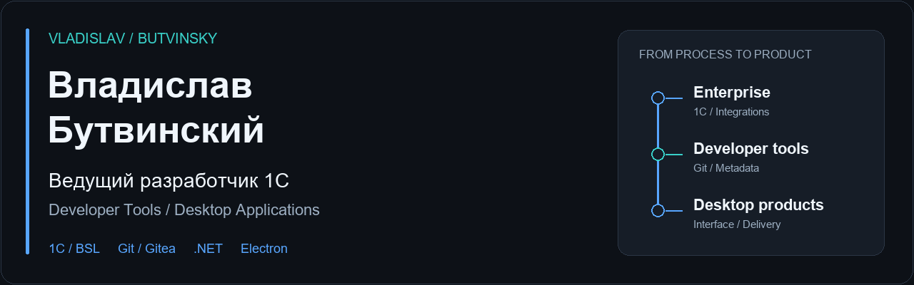
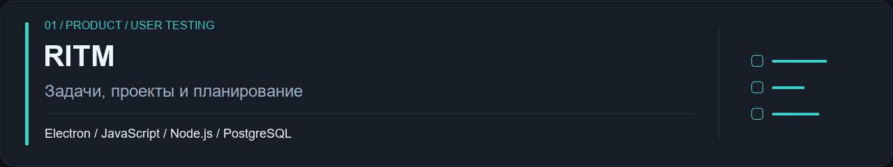
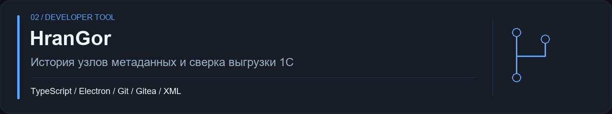
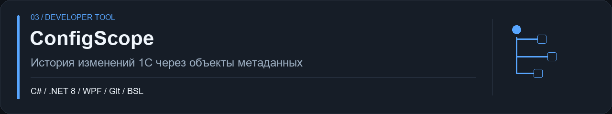
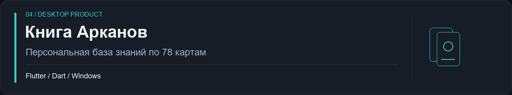

  

# Владислав Бутвинский

**Ведущий разработчик 1С · Продукты для работы и планирования · Инструменты для разработчиков**

Разрабатываю корпоративные решения на **1С:Предприятие** и собственные приложения для автоматизации рабочих процессов. Прохожу с продуктом путь от задачи и архитектуры до интерфейса, установки и обновлений. Отдельное направление — инструменты, которые помогают командам разбирать изменения конфигураций 1С через Git.

## Проекты

### RITM

Приложение для задач, проектов и планирования. Объединяет недельный и месячный планировщик, аналитику, диаграммы Ганта и совместную работу. Развиваю синхронизацию между устройствами, создание задач из писем и интеграцию с Telegram.

**Инженерная часть:** локальное хранение и резервные копии, серверный API на Fastify/PostgreSQL, очередь синхронизации. Сборки для Windows и Linux и браузерная версия проходят пользовательское тестирование.

**Исходный код закрыт.** [Описание, установка и публичные релизы →](https://github.com/butvinskiyvsr-cmyk/ritm-releases)

### HranGor

Windows-приложение для исследования конфигураций 1С через Git/Gitea. Показывает историю каждого узла метаданных с автором и временем изменения, сверяет локальную XML-выгрузку с серверной историей и отделяет форматные правки от содержательных.

**Инженерная часть:** индексатор истории, смысловое сравнение XML, тесты ядра и автоматические обновления.

**Исходный код закрыт.** [Описание, установка и публичные релизы →](https://github.com/butvinskiyvsr-cmyk/hrangor-releases)

### ConfigScope

Windows-приложение для просмотра изменений конфигураций 1С в Git. Группирует изменения по объектам метаданных, показывает историю выбранного объекта и построчное сравнение BSL/XML. Работает с несколькими локальными репозиториями и Git-серверами.

**Инженерная часть:** слои Domain, Application и Infrastructure, автоматические тесты, обновления с проверкой SHA-256 установщика.

**Открытый исходный код:** [репозиторий, документация и релизы →](https://github.com/butvinskiyvsr-cmyk/onec-change-monitor)

### Книга Арканов

Настольный справочник по картам Таро: 78 карт, собственные тексты, сочетания, заметки, поиск и две темы оформления. Значения карт пользователь заполняет самостоятельно.

**Инженерная часть:** отделение пользовательских данных от описания колоды, автоматическое сохранение через временный файл и ежедневные резервные копии.

**Исходный код закрыт.** [Описание, установка и публичные релизы →](https://github.com/butvinskiyvsr-cmyk/kniga-arkanov-releases)

## Технологии

| Направление | Использую |
| --- | --- |
| Корпоративная разработка | 1С:Предприятие · BSL · управляемые и обычные формы · интеграции |
| Настольные приложения | C# · .NET 8 · WPF · Electron · Flutter · Dart |
| Интерфейс и сервер | JavaScript · TypeScript · HTML/CSS · Node.js · Fastify · PostgreSQL |
| Разработка и доставка | Git · Gitea · GitHub Actions · Docker Compose |

## Подход к работе

Уделяю внимание сохранности данных, понятной диагностике и работе приложения после установки. Закладываю тесты, обновления и документацию в процесс разработки, а не оставляю их на конец проекта.

## Контакты

- **Почта:** [butvinskiyv.sr@gmail.com](mailto:butvinskiyv.sr@gmail.com)
- **Telegram:** [@Alexis0401](https://t.me/Alexis0401)
- **GitHub:** [@butvinskiyvsr-cmyk](https://github.com/butvinskiyvsr-cmyk)
